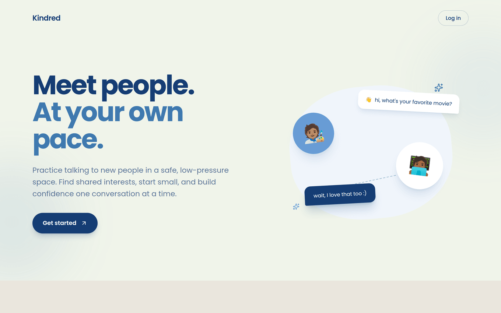
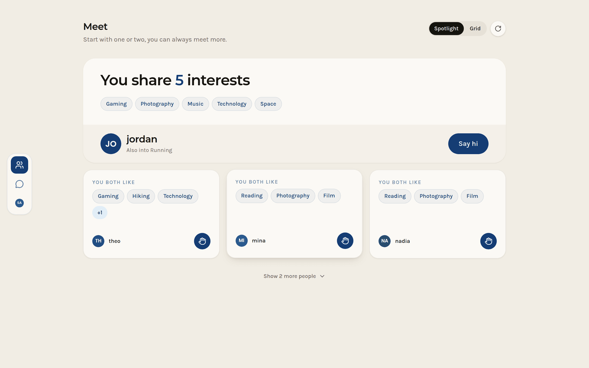
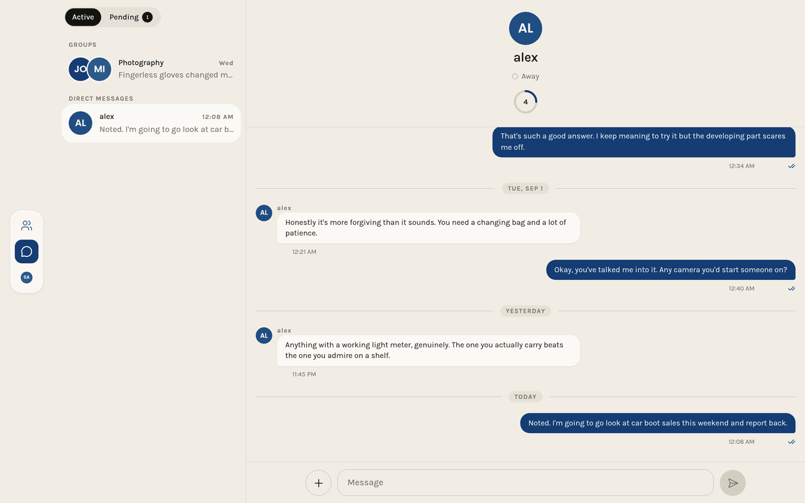
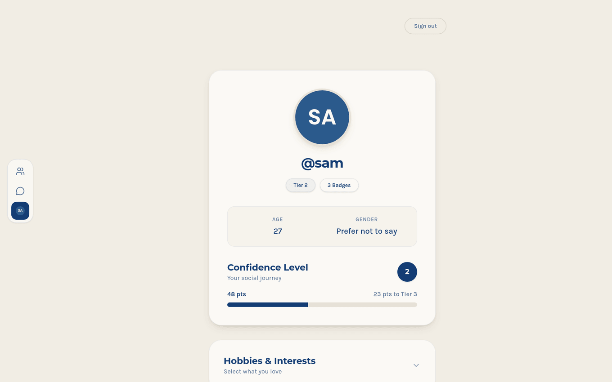
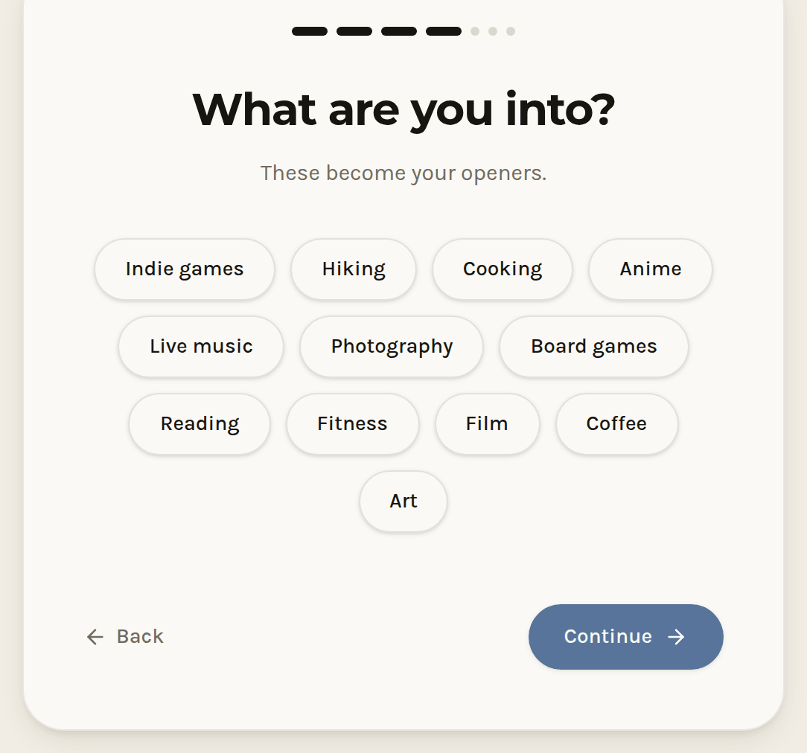
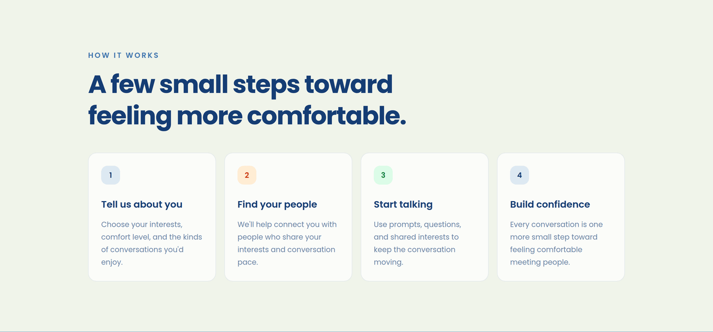
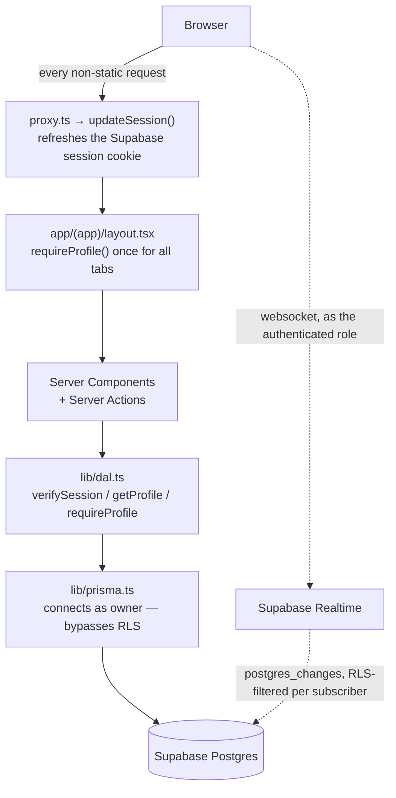
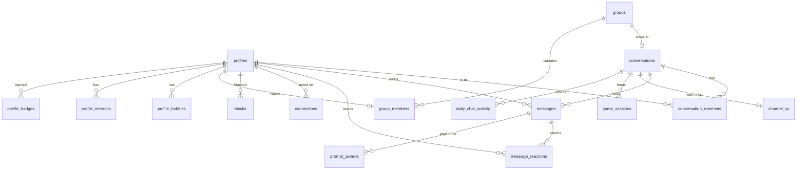

# Kindred

**Meet people. At your own pace.**

[(https://github.com/Craqpster/Kindred/actions/workflows/ci.yml)
[](https://opensource.org/licenses/MIT)

> **Status: the live app is currently down.** Supabase paused this project's database due to inactivity, so the deployed site on Vercel (https://kindred-one-lovat.vercel.app/) cannot connect to a database and will not work beyond the landing page until the database is restored. The code here is complete and runnable locally once you point it at a live Supabase project (see [Getting started](#getting-started)).

Kindred is a low-pressure social app for people who find meeting strangers hard. It matches you
with others who share your hobbies and interests, hands you openers so you never have to start
from a blank page, and quietly rewards the small acts of showing up — a real reply, an answered
icebreaker, both of you turning up on the same day.

It is deliberately **not a dating app**. There is no swiping, no photos, no performance. Matching
is on shared interests and on how you said you wanted to ease in, and the whole product is built
around comfort: block anyone, hide any part of your profile, and every message passes moderation
before it exists.

> Built with Next.js 16 (App Router), React 19, Supabase (auth + Realtime + Postgres), Prisma 7
> and Tailwind CSS v4.

<p align="center">
  
</p>

---

## Contents

- [Screenshots](#screenshots)
- [What's in the box](#whats-in-the-box)
- [Tech stack](#tech-stack)
- [Repository layout](#repository-layout)
- [Getting started](#getting-started)
- [Environment variables](#environment-variables)
- [Commands](#commands)
- [Architecture](#architecture)
- [Data model](#data-model)
- [Confidence, XP and levels](#confidence-xp-and-levels)
- [Safety and moderation](#safety-and-moderation)
- [Database and migrations](#database-and-migrations)
- [Security model](#security-model)
- [Contributing](#contributing)
- [Known limitations](#known-limitations)
- [Further reading](#further-reading)

---

## Screenshots

<table>
  <tr>
    <td width="50%" valign="top">
      
      <p><b>Meet</b> — one person, explained properly, with the tags you have in common and a
      one-line reason. The rest are a click away rather than laid out ten at a time.</p>
    </td>
    <td width="50%" valign="top">
      
      <p><b>Chats</b> — DMs and groups in one list, split into Active and Pending. The ring under
      the name is that conversation's shared level; presence and unread badges work from every tab.</p>
    </td>
  </tr>
  <tr>
    <td width="50%" valign="top">
      
      <p><b>Your profile</b> — confidence tier and progress to the next one, badges, and a switch
      for every section so you choose what other people see.</p>
    </td>
    <td width="50%" valign="top">
      
      <p><b>Onboarding</b> — seven short steps. The interests you pick here are what the matcher
      scores on, and what your first openers are made of.</p>
    </td>
  </tr>
</table>

<p align="center">
  
</p>

> Captured from the app running locally against seeded development data. Profiles here use the
> built-in initials avatar; a real account picks a generated one during onboarding.

---

## What's in the box

### Onboarding
A seven-step wizard (`/onboarding`) that asks for as little as it can get away with: a handle, a
generated avatar (nine [DiceBear](https://www.dicebear.com/) styles, with a shuffle for a
different face in the same style), the hobbies and interests that become your openers, how you
want to ease in, an optional gender, and a date of birth. Kindred is 18+, and age is always
derived from `birth_date` — no age column exists to go stale.

The ease-in answer (`openers` / `gradual` / `volume`) is not decoration: the matcher scores it,
and a match card explains *why* two people were put in front of each other.

### Meet
`/meet` ranks candidates by shared hobby and interest names, plus a point for a matching ease-in
answer, and takes the top ten. It leads with **one** spotlighted person explained properly rather
than laying ten strangers out at once — three runners-up sit below, the rest are one click away,
and a toggle switches to a flat grid for anyone who prefers it.

Saying hi creates the conversation as a *wave* (pending until the other person accepts) and the
Kindred bot posts an icebreaker into it. Anyone you have acted on never resurfaces on Meet; the
conversation is where they live from then on.

### Groups
`/meet` also offers to find you a group: three to four ungrouped people who share your top tag,
assembled atomically so nobody can be claimed twice. The group chat then lives pinned above your
other conversations.

### Chat
DMs and group chats run on Kindred's own Postgres tables with **Supabase Realtime** delivering
changes to the browser. One subscription serves the whole authenticated shell, so unread badges
and new-message toasts work from `/meet` and `/me` too — not just from `/chats`.

- Pending and Active tabs, filtered in SQL rather than partitioned in the client
- Live presence ("active / idle / away") and typing indicators
- Six-emoji reactions with an allowlist shared by the picker and the server validator
- Edit and soft-delete your own messages
- A composer menu for requesting an icebreaker or inviting someone to a game
- A per-conversation XP ring in the header, with a popover that states the real award amounts

### Games
Tic-Tac-Toe and Connect Four, playable inside a conversation. Both games' rules live in one pure
module per game that the board *and* the server import — `playGameMove` takes a move, not a board,
and recomputes with the same functions the UI draws with, so the client cannot referee itself. An
invite is a message; the first person to join wins it atomically. A game untouched for 24 hours is
marked abandoned the next time anyone reads it (there is no background worker).

### Profiles, badges and privacy
`/me` edits your profile; `/u/[id]` is how someone else sees it. Every section is
independently switchable — confidence tier, interests, badges, and whether your DMs are open.
Badges are seeded reference rows (Ice Breaker, Social Butterfly, Kindred Spirit, Open Book, Game
Starter, Game Winner, Game Finisher, and more) awarded for behaviours rather than bought.

### Safety
Blocking is one-directional to record and symmetric to read: a row in either direction hides both
people from each other on Meet, hides the conversation from both lists, and refuses sends. Only
the person who did it can undo it. Blocked people are managed from `/me`.

### Auth
Supabase email/password with an email confirmation route and a full forgot-password →
reset-password flow.

---

## Tech stack

| Layer | Choice | Notes |
| --- | --- | --- |
| Framework | **Next.js 16.2.10**, App Router | `proxy.ts` is Next 16's middleware equivalent |
| UI | **React 19.2.4**, TypeScript 5 | Server Components by default, Server Actions for writes |
| Styling | **Tailwind CSS v4** | CSS-first `@theme` in `app/globals.css`; there is no `tailwind.config` |
| Auth | **Supabase Auth** via `@supabase/ssr` | Cookie session refreshed on every non-static request |
| Database | **Supabase Postgres** + **Prisma 7.8** | `@prisma/adapter-pg` driver adapter; client generates to `lib/generated/prisma` |
| Realtime | **Supabase Realtime** (`postgres_changes`) | RLS-filtered per subscriber; presence/typing on a per-conversation channel |
| Validation | **zod 4** | Every Server Action re-validates its own input |
| Moderation | **obscenity** + **OpenAI moderation API** | Local list first, network call only for what passes |
| Motion / icons | **motion**, **lucide-react**, **Radix UI** primitives | |
| Avatars | **DiceBear** (`api.dicebear.com`) | Style + seed stored per profile |

---

## Repository layout

The app lives one level below the repo root. **Every command in this README runs from `kindred/`.**

```
Kindred/
├── README.md              ← you are here
└── kindred/               ← the Next.js app
    ├── app/
    │   ├── (app)/         ← the authenticated shell; layout calls requireProfile() once
    │   │   ├── meet/      ← matching, groups
    │   │   ├── chats/     ← conversations, messages, games
    │   │   ├── me/        ← your own profile
    │   │   └── u/[id]/    ← someone else's profile
    │   ├── api/profile/   ← badges, interests, privacy
    │   ├── auth/          ← sign-up/in/out actions + email confirm route
    │   ├── onboarding/    ← the seven-step wizard
    │   ├── login/ signup/ forgot-password/ reset-password/
    │   ├── globals.css    ← the design tokens; use these, never raw hex
    │   └── page.tsx       ← the landing page
    ├── components/        ← app, auth, chat (+ games), homepage, meet, onboarding, profile, ui
    ├── lib/
    │   ├── dal.ts         ← the ONLY sanctioned way to read the current user
    │   ├── prisma.ts      ← connects as owner; bypasses RLS by design
    │   ├── chat/          ← mutations, queries, mapping, moderation, realtime, reactions
    │   ├── matches.ts groups.ts games.ts blocks.ts prompts.ts
    │   └── confidence*.ts chat-level.ts   ← the XP maths, shared by server and client
    ├── prisma/
    │   ├── schema.prisma  ← covers both `public` and the introspected Supabase `auth` schema
    │   └── migrations/    ← hand-written SQL, applied with `migrate deploy`
    ├── scripts/           ← the verify:* scripts and dev helpers
    ├── utils/supabase/    ← browser, server and middleware clients
    ├── docs/              ← setup, conventions, and the chat rework plan
    └── proxy.ts           ← refreshes the Supabase session cookie
```

---

## Getting started

### Prerequisites

- **Node 20.9+** (Next 16's minimum). Kindred is developed against **Node 24**.
- Access to a Supabase project. The original project's database is currently paused due to inactivity, so set up your own free Supabase project and use its credentials in `.env`. There is no local database to install — Postgres lives in Supabase.
- An **OpenAI API key**, optionally. Moderation fails open, so the app runs without one.

### 1. Clone and enter the app

```bash
git clone https://github.com/Craqpster/Kindred.git
cd Kindred/kindred
```

### 2. Secrets

The one thing git cannot give you — `.env` is gitignored on purpose.

```bash
cp .env.example .env     # Windows (cmd): copy .env.example .env
```

Then fill in the five values. `.env.example` says exactly which Supabase dashboard tab each one
comes from. Copy them from another machine through something private, or re-read them from the
dashboards — **never** email, chat, a gist, or a PR description. These are live database
credentials, and rotating a leaked one is a much worse afternoon than copying a file.

### 3. Install

```bash
npm install
```

`postinstall` runs `prisma generate`, which writes the Prisma client into `lib/generated/` — a
**gitignored** directory. A fresh clone therefore has no Prisma client at all until this step, and
type errors before it are expected and mean nothing.

Do step 2 first. `prisma generate` needs no database, but the CLI loads `prisma.config.ts`, which
warns loudly when `DIRECT_URL` is missing. Install still finishes; nothing that talks to Postgres
will run until `.env` exists.

### 4. Check the database agrees with the repo

```bash
npx prisma migrate status
```

This should report everything applied. If it lists migrations as pending, **stop and read
[`docs/conventions.md`](kindred/docs/conventions.md) §1** before running anything — this project
has been out of step before, with five migrations applied straight to Supabase and never
committed.

### 5. Run it

```bash
npm run dev
```

Open <http://localhost:3000>.

### 6. Prove it works

```bash
npm run verify:chat
```

Checks against the live database that the CHECK constraints reject malformed rows, the
`last_message_at` trigger behaves, and RLS shows each person only their own conversations. Every
check runs inside a transaction that is rolled back, so it writes nothing.

### Testing with two accounts

Saying hi writes a `connections` row, and Meet permanently excludes anyone you have one with —
right for real use, exhausting for testing, because two accounts use each other up on the first
wave.

```bash
npm run reset:connections              # clear every row
npm run reset:connections alex ally    # just that pair, both directions
```

Conversations and messages are untouched; this only forgets who has already been greeted.

---

## Environment variables

All five live in `kindred/.env`. See [`.env.example`](kindred/.env.example) for the annotated
version.

| Variable | Required | What it is |
| --- | --- | --- |
| `DATABASE_URL` | yes | Supabase **transaction** pooler (port 6543). Used by Prisma Client at runtime. |
| `DIRECT_URL` | yes | Supabase **session** pooler (port 5432). Used by the Prisma CLI. Migrations cannot run through the transaction pooler — it cannot hold the advisory locks they take. |
| `NEXT_PUBLIC_SUPABASE_URL` | yes | Your Supabase project URL. |
| `NEXT_PUBLIC_SUPABASE_PUBLISHABLE_KEY` | yes | The browser's key. It carries no privileges of its own — what a signed-in user may read is decided by RLS, and the browser has no write grant at all. |
| `OPENAI_API_KEY` | no | Second layer of message moderation. Without it, moderation falls back to the local word list and otherwise fails open. |

URL-encode special characters in the database password (`@` → `%40`, `#` → `%23`, `/` → `%2F`).
An unescaped character surfaces as a confusing `P1000: authentication failed`.

---

## Commands

Run from `kindred/`.

| Command | What it does |
| --- | --- |
| `npm run dev` | Next dev server |
| `npm run build` | Production build |
| `npm run lint` | ESLint (flat config, `eslint-config-next` core-web-vitals + TypeScript) |
| `npm run verify:chat` | The chat RLS policies, proved to actually filter. Connects as the `authenticated` role with an impersonated `request.jwt.claims` — the same evaluation Realtime performs. Needs `DIRECT_URL`. |
| `npm run verify:games` | Both games' rules, which the server enforces. Pure. |
| `npm run verify:reactions` | The reaction state machine, which has to be idempotent. Pure. |
| `npm run verify:xp` | The chat-level maths behind the XP ring. Pure. |
| `npm run verify:moderation` | The strike escalation, end to end against the database. Writes real rows and clears them. |
| `npm run reset:connections` | Dev only: forget who has already been greeted so `/meet` has cards again. |
| `npx prisma migrate status` | **Always run this before applying anything.** |
| `npx prisma migrate deploy` | Apply pending migrations. Never `migrate dev` — see below. |
| `npx prisma generate` | Regenerate the client into `lib/generated/prisma`. |
| `npx prisma db pull` | Re-introspect Supabase, including the `auth` schema. |

There is no unit test suite. The `verify:*` scripts are the closest thing, and each is worth
running when you touch what it covers.

### What "done" means

```bash
npm run lint          # zero problems, not "only warnings"
npm run build
npm run verify:chat
```

---

## Architecture

### Request path



### Auth and data access, in order

1. **`proxy.ts`** (Next 16's middleware equivalent) runs `updateSession` on every non-static
   request to refresh the Supabase session cookie.
2. **`lib/dal.ts`** is the only sanctioned way to read the current user. `verifySession()`
   requires a session and redirects to `/login`; `getProfile()` requires a session but tolerates
   no profile (what `/onboarding` needs); `requireProfile()` requires both and redirects to
   `/onboarding`. All are `cache()`-wrapped, so calling them repeatedly in one render is free.
3. **Prisma connects as `postgres` and bypasses row level security.** There is no RLS backstop on
   the server — every query must sit behind a DAL call and be scoped by the authenticated user id
   explicitly. An id from the client is only ever used to *narrow* a query that is already
   restricted to what the viewer can see.

Route groups encode the gate. `app/(app)/*` is the authenticated shell; `/login`, `/signup`,
`/onboarding` and the landing page live outside it.

### Chat

Four tables own chat — `conversations`, `conversation_members`, `messages`, `message_reactions`.
A DM and a group are the same row shape, distinguished by `kind`.

- **Writes go through `lib/chat/mutations.ts`, never the browser.** Moderation, XP and the
  membership check all run *inside* `sendMessage`, so a crafted client cannot skip them. The
  Server Actions in `app/(app)/chats/actions.ts` are thin wrappers that re-derive the user id
  from the session and bound the ids with zod.
- **Reads for the UI go through Prisma** as the owner role. RLS is not what protects them; the DAL
  and explicit user-id scoping are.
- **RLS exists for exactly one consumer**: the browser's realtime socket, which connects as
  `authenticated` and holds `SELECT` and nothing else. `npm run verify:chat` proves the policies
  filter by impersonating that role in SQL.
- **A policy is only consulted after a `GRANT`.** The `public` schema had no ACL at all, which is
  why `20260725010000_grant_chat_read_to_authenticated` exists. Without it the subscription would
  have silently delivered nothing, forever, without erroring. *If a subscription is silent, check
  the grant before you debug the policy.*
- **One subscription for the entire authenticated shell**, held by
  `components/chat/ChatRealtimeProvider.tsx` — not by `/chats`. Unread badges and toasts have to
  work from every tab, and subscribing per visit is what made the old implementation racy.
- The subscription is **unfiltered on purpose**: `postgres_changes` filters allow a single
  `column=eq.value`, so "messages in any of my conversations" cannot be expressed as one. RLS does
  that job per subscriber instead.
- **Nothing calls `realtime.setAuth()`, and nothing should.** supabase-js passes an `accessToken`
  callback into its realtime client and re-pushes on `INITIAL_SESSION` / `TOKEN_REFRESHED`, so the
  cookie-backed session reaches the socket on connect and after every refresh.
- `dm_key` (`least(a,b):greatest(a,b)`, unique) makes waving at the same person twice reuse the
  conversation. `conversations.group_id` (unique) does the same for a group, which is what makes
  group creation idempotent and retryable.
- **The Kindred bot is `messages.sender_id IS NULL`**, not a profile row — a profile needs an
  `auth.users` row behind it and the bot has no account, so absence is the marker.

### Meet and matching

`lib/matches.ts` scores candidates in JS: shared hobby and interest names, plus a point for a
matching ease-in answer, top ten. Deliberately naive — swap for a SQL aggregate over the junction
tables if the user base grows.

`sayHi` writes the conversation first and the `connections` row second, so a failure leaves the
card retryable rather than hiding someone with no conversation to show for it. `findMyGroup`
deliberately does the **opposite**: a `group_members` row is a *claim* on people who can each be
claimed only once, so it has to be taken atomically before anything observable happens. The window
that opens (group committed, conversation missing) is what the group card's repair state exists
for, and `createGroupConversation` is keyed by `group_id` so retrying finishes the job instead of
forming a second group.

---

## Data model

`prisma/schema.prisma` covers both the `public` schema and the introspected Supabase `auth`
schema. The generated client is imported as `@/lib/generated/prisma/client`, not `@prisma/client`.

Several invariants are CHECK constraints Prisma cannot model — `ease_in` values,
`confidence_level >= 1`, `connections.status`, the DM/group shape rules — so they live in the
migration SQL and are documented in schema comments.



A few decisions worth knowing before you touch a table:

- **`channel_xp` is per-conversation and shared**; `profiles.confidence_points` is per-person and
  global. They are separate stats, not the same number in two places.
- **`conversations.last_message_at` is written only by the `messages_touch_conversation`
  trigger**, never by application code — the UPDATE it performs is also the realtime signal the
  chat list reorders on.
- **Composite primary keys are the claim.** `prompt_awards`, `daily_bonus_awards` and
  `message_reactions` all rely on the insert itself being the once-only guarantee, so a replay or
  a race loses instead of paying twice.
- **`connections` records something that happened and is never removed; `blocks` is a state
  someone can leave**, so unblocking is a delete. That is why they are separate tables rather than
  a status column.
- **Age is derived from `birth_date`** via `lib/age.ts`. Storing an integer age goes stale
  silently.

---

## Confidence, XP and levels

Two counters, deliberately separate:

| | Chat level | Confidence tier |
| --- | --- | --- |
| Stored in | `channel_xp.xp` (per conversation) | `profiles.confidence_points` → `confidence_level` |
| Scope | Shared by everyone in that chat | One person, across the whole app |
| Curve | Each level costs more than the last — 5 XP to reach level 2, 10 more for level 3 — so total XP at level *L* is `5·L(L−1)/2` | Tier 1 from 0 points, tier 2 at 31, tier 3 (the cap) at 71 |
| Rendered by | The ring in the conversation header | The card on your profile |

A message earns XP only if it is **at least 15 characters** and a **genuine back-and-forth turn** —
the previous message came from someone else, not from you again. That filters out "ok", "lol" and
a lone emoji without being strict about it.

| Award | Amount |
| --- | --- |
| A qualifying message | **1 XP** |
| Answering an icebreaker | **3 XP** (once per person per prompt, enforced by `prompt_awards`) |
| Daily cap on ordinary chatter | **10 XP** per person, per chat, per UTC day |
| Mutual daily bonus | **5 XP, plus 2 more per chat level above the first** — paid once both people clear the day's message threshold |

The cap is what stops confidence tier being a measure of typing stamina; the mutual bonus is what
volume alone cannot fake, because it needs the other person to genuinely show up. The daily tally
keeps climbing past the cap — only the *payment* stops — so a high-level chat can still reach its
own bonus threshold.

The maths lives in `lib/chat-level.ts` and `lib/confidence-xp.ts`, imported by both the server that
awards and the client that renders, so the badge repeats the server's arithmetic rather than
approximating it. `npm run verify:xp` pins it.

---

## Safety and moderation

`lib/chat/moderation.ts` is two layers:

1. **`lib/word-filter.ts`** — the `obscenity` list, local and free, runs first, so the common case
   never makes a network request.
2. **OpenAI's moderation endpoint** — only for what passes layer one.

It **fails open**: a moderation outage lets messages through rather than taking chat down with it.

It runs **inside `sendMessage`, before the row exists** — which is the part that matters. It used
to be an advisory API route the browser called before posting, so a client that simply didn't call
it was unmoderated. There is no longer a route to skip.

A flagged message is always blocked from sending. `lib/moderation-rate-limit.ts` allows **two
warnings** inside a three-minute window before an escalating cooldown starts:

| Strike (within the window) | Consequence |
| --- | --- |
| 1st, 2nd | Blocked, warning only |
| 3rd | 30 seconds |
| 4th | 2 minutes |
| 5th | 5 minutes |
| 6th | 15 minutes |
| 7th and beyond | 30 minutes |

Strikes live in the `moderation_state` table, one row per profile. They were a module-level `Map`
until `20260802000000`, which failed exactly where it mattered: serverless invocations do not share
memory, so reaching three strikes needed three requests to land on the same warm instance, and a
deploy wiped every count. `npm run verify:moderation` prints the escalation end to end.

---

## Database and migrations

### Never run `prisma migrate dev` on this project

Use `npx prisma migrate deploy`.

`migrate dev` reruns the migration history in a shadow database to detect drift, and **offers to
reset the real one** when it finds any. This schema finds it every time: it covers the introspected
Supabase `auth` schema alongside `public`, and Supabase adds tables there on its own schedule — so
a schema-diff-based command reads Supabase's own auth tables as drift and offers to "fix" it by
dropping them.

Write migration SQL by hand (copy the shape of a neighbouring folder) and apply it with
`migrate deploy`, which only applies what is pending, never resets, and warns rather than acts if
an applied migration file changed.

### Always check before you assume the database matches the repo

```bash
npx prisma migrate status
```

On 2026-07-25 this project had **five migrations in the database that existed nowhere in git**. Two
consequences, both discovered weeks later: the repo could no longer rebuild its own database, and
one of those migrations had dropped a table that `lib/confidence.ts` was still inserting into —
inside a transaction, so **every XP award that reached the daily bonus threshold had silently been
paying out nothing**.

If you change the database, the migration file goes in git in the same breath.

### Connection strings are split on purpose

`DATABASE_URL` is the transaction pooler (6543) used by Prisma Client at runtime; `DIRECT_URL` is
the session pooler (5432) handed to the CLI by `prisma.config.ts`. Migrations cannot run through
the transaction pooler — it cannot hold advisory locks. The Prisma CLI runs outside Next's env
loader, so `prisma.config.ts` imports `dotenv/config` explicitly.

---

## Security model

Four things to internalise before writing a query:

1. **Prisma connects as the owner and bypasses RLS.** There is no server-side backstop. Every
   query sits behind a DAL call and is scoped by the authenticated user id explicitly.
2. **RLS exists for exactly one consumer** — the browser's realtime socket. Those policies are read
   filters for subscribers, not authorization for writes; the browser has `SELECT` and nothing
   else.
3. **Server Actions are reachable by direct POST**, not only through your forms. Every one
   re-validates its input with zod and re-derives the user id from the session, never from the
   payload.
4. **A policy is only consulted after a `GRANT`.** A missing grant makes a policy unreachable and
   a subscription silent — the worst possible failure shape, because nothing errors.

Never commit `.env`. `.gitignore` covers `.env*` and lets `.env.example` through, which is the only
one that should ever be committed.

---

## Contributing

The full version is [`docs/conventions.md`](kindred/docs/conventions.md), and it is worth reading —
everything in it is either something that has already gone wrong on this project or something that
would be expensive to undo. The short version:

**Process**

- **Branch before editing.** Never commit to `main` directly, even for a one-line fix.
- **Don't mix a refactor into a feature.** Two commits, or two PRs — otherwise a reviewer cannot
  tell which lines are which, and neither can `git bisect` six months later.
- **Don't refactor code that is scheduled for deletion.**
- **Don't commit generated files.** `lib/generated/` is rebuilt by `postinstall`.
- **Delete dead code instead of tidying it** — but check `git log` first, because recent activity
  may mean half-finished work rather than an oversight.

**Code**

| Layer | Convention | Example |
| --- | --- | --- |
| Database columns | `snake_case` | `last_message_at` |
| TypeScript | `camelCase` | `lastMessageAt` |
| Types | `PascalCase` | `ChatMessage` |
| Booleans | read as a claim | `awaitingYou`, not `flag` |

The translation between the first two rows happens in exactly one place — `lib/chat/mapping.ts` —
so no component ever holds a database row.

- **Never `any`.** The repo went from 27 lint errors to zero and most of them were `any`.
- **Named arguments once there are two ids.** `isMember({ conversationId, userId })`, never
  `isMember(conversationId, userId)` — both are uuid strings, so the wrong order compiles and then
  denies access forever. A plausible wrong answer is worse than a crash.
- **One file, one job.** If you cannot describe a file's job in one sentence without "and", that is
  the seam.
- **Comments explain *why*.** The code already says what it does.

**Design**

- Use the palette tokens in `app/globals.css` (`bg-mist`, `text-star-sapphire`, `bg-canvas`,
  `text-accent`, …), never raw hex. The Meet surfaces use a newer warm/green set that sits
  alongside the original blues rather than replacing them.
- Fonts are theme tokens: `font-display` (Montserrat), `font-body` (Karla), default sans is
  Poppins. Never `font-[var(--font-x)]` — that form is ambiguous and `font-bold` silently overrides
  it.
- **No red, pink or coral** (reads romantic — this is explicitly not a dating app) and **no purple**
  (reads as Discord). Green carries the growth note.

**And the theme running through all of it: verify, don't assert.** The missing grant, the phantom
migrations, the byte-identical duplicate file, the `any` that wrote to the wrong column — every one
was found by checking, and none of them looked wrong from the outside. When you are about to say
"that should be fine", that is the moment to run the command.

---

## Known limitations

Not bugs. Decisions with a cost, written down so the next person inherits the reasoning rather than
rediscovering the symptom.

- **Reaction removals reach everyone.** Realtime evaluates RLS against the row it forwards, and a
  DELETE payload carries only the replica identity — not enough to run a policy. So reaction
  *additions* are filtered per subscriber and *removals* are not. What escapes is a
  `(message_id, profile_id, emoji)` triple for a message the recipient cannot read; `applyReaction`
  ignores ids the timeline is not holding, so nothing renders. Closing it properly means
  soft-deleting reactions so a removal becomes an UPDATE with a full row to check.
- **Realtime has a ceiling in the low hundreds of concurrent subscribers.** Unfiltered
  `postgres_changes` means RLS is evaluated per subscriber per change. The escape hatch is
  broadcast-from-database: `realtime.broadcast_changes()` in an AFTER INSERT trigger, fanned out to
  a per-user topic. Same client shape, different plumbing.
- **The chat list is capped at 100 conversations.** It runs in the app-shell layout, on every page,
  because the unread badges it feeds work from everywhere. Someone who reaches the cap needs paging
  in the sidebar — a feature, not a number to raise.
- **Matching is O(candidates) in JS.** Fine at this size; swap for a SQL aggregate over the junction
  tables if the user base grows.
- **Games go stale lazily.** There is no background worker, so an abandoned game is only discovered
  the next time someone reads it.
- **Threads, replies and pinned messages exist in the schema and the types but have no UI yet.**
  Threading is one level deep by design, and the "parent must itself be top-level" half of that is
  enforced in `lib/chat/mutations.ts`, since a CHECK cannot see the parent row.
- **There is no automated test suite** beyond the `verify:*` scripts.

---

## Further reading

| Document | What's in it |
| --- | --- |
| [`kindred/docs/setup.md`](kindred/docs/setup.md) | Setting up on another machine, step by step |
| [`kindred/docs/conventions.md`](kindred/docs/conventions.md) | Working on Kindred — every rule, with the incident behind it |
| [`kindred/docs/chat-rework-plan.md`](kindred/docs/chat-rework-plan.md) | The Stream → Supabase Realtime migration, phase by phase |
| [`kindred/.env.example`](kindred/.env.example) | Annotated environment variables |

---

## Credits and license

Built by the Kindred team — see the repository's
[contributors](https://github.com/Craqpster/Kindred/graphs/contributors).

Licensed under the MIT License — see [LICENSE](LICENSE).
